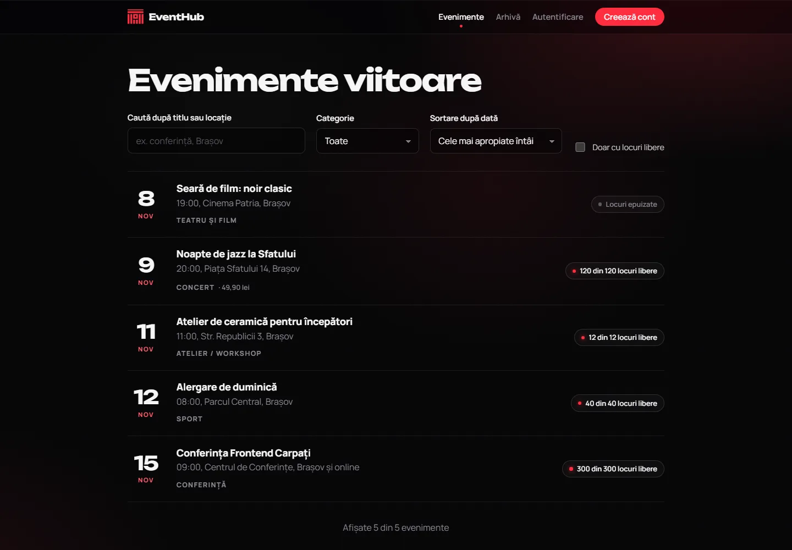
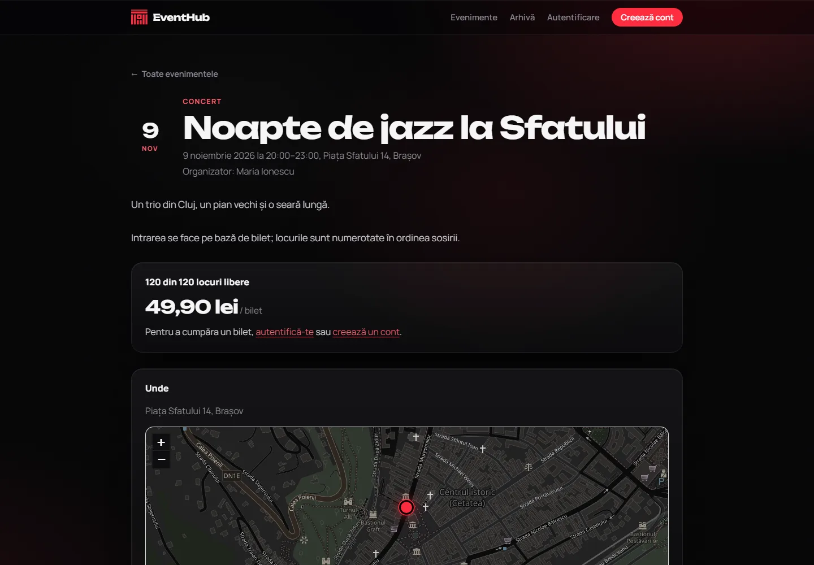
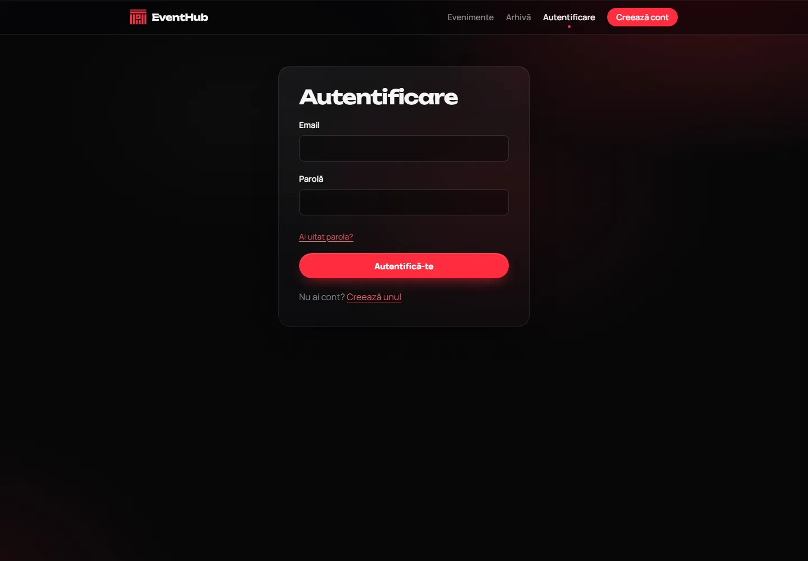
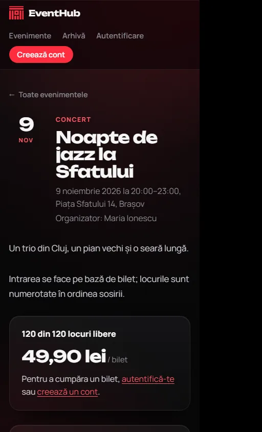

# EventHub

Aplicație web pentru organizarea evenimentelor și gestionarea înscrierilor.
**Stack:** React (Vite, TypeScript) · NestJS (TypeScript, REST) · PostgreSQL · TypeORM · JWT.

## Pornire rapidă

```bash
# 0. Secretele (o singură dată): generează parolele și cere codul de invitație
#    Windows:  powershell -ExecutionPolicy Bypass -File .\setup-secrets.ps1
#    Mac/Linux: sh setup-secrets.sh

# 1. Totul în Docker: PostgreSQL + API + frontend (nginx)
docker compose up --build        # aplicația pe http://localhost:5173, API pe http://localhost:3000/api

# 2. sau, pentru dezvoltare pe frontend (reîncărcare la salvare): backend-ul în Docker, frontend-ul local
docker compose up --build db backend
cd frontend && npm install && npm run dev   # tot http://localhost:5173
```

În Docker, frontend-ul e servit de nginx cu antete de securitate, inclusiv **Content-Security-Policy**
(`frontend/nginx/default.conf.template`): scripturi doar de pe site (+ Cloudflare Turnstile), conexiuni doar spre API (+ Sentry),
imagini de la API, OpenStreetMap și Cloudinary, fără încadrare în alte site-uri. Adresa API-ului intră în build (`PUBLIC_API_URL`),
iar originea ei în CSP la pornire (`API_ORIGIN`, implicit `http://localhost:3000`).

Fără Docker pentru backend: pornește doar `docker compose up db`, apoi
`cd backend && cp .env.example .env`, completează în `.env` aceleași valori ca în `secrets/*.txt` și rulează `npm install && npm run start:dev`.

Datele sunt păstrate în volumul Docker `pgdata` și rămân după repornire.
Tabelele se creează prin migrări, rulate automat la pornirea API-ului (vezi [Migrări](#migrări)). O bază creată înainte de migrări este recunoscută și păstrată.

## Configurare

- **Adresa API-ului (frontend):** `VITE_API_URL` în `frontend/.env` (implicit `http://localhost:3000/api`, din `.env.development`).
  Toate cererile trec prin `src/api.ts`, care folosește `API_URL` din `src/config.ts`; nu există adrese scrise direct în pagini.
- **Conturi de organizator:** se creează doar cu codul de invitație din `secrets/organizer_invite_code.txt`.
  Dacă lipsește, nimeni nu se poate înregistra ca organizator.
  Participanții se înregistrează liber. Codul se dă doar persoanelor de încredere.

## Secrete

Nicio valoare secretă nu este în cod sau în `docker-compose.yml`. Sunt în `secrets/`
(`db_password.txt`, `jwt_secret.txt`, `organizer_invite_code.txt`, `resend_api_key.txt`, `cloudinary_url.txt`), ignorat de Git. Docker Compose le
declară în secțiunea `secrets:` și le montează în containere ca fișiere în `/run/secrets`,
deci nu apar în `docker inspect`, în imagini sau în `docker compose config`. Backend-ul le citește prin
`NUME_FILE` (vezi `backend/src/common/secrets.ts`) și nu pornește dacă lipsește `JWT_SECRET` sau parola bazei de date.
PostgreSQL este expus doar pe `127.0.0.1`. Frontend-ul nu conține secrete: variabilele `VITE_*` ajung în browser, deci acolo se pune doar adresa publică a API-ului.

Dacă schimbi `db_password.txt` după ce baza a fost creată, rulează `docker compose down -v` (șterge datele locale), altfel parola din volum rămâne cea veche.

`resend_api_key.txt` și `cloudinary_url.txt` sunt opționale, dar fișierele trebuie să existe (pot fi goale), altfel `docker compose` nu pornește.
Dacă ai rulat scriptul de secrete înainte de ele, rulează-l din nou: creează doar fișierele care lipsesc.

## Teste și verificări

Fiecare push / pull request rulează **CI** (`.github/workflows/ci.yml`): pentru backend și frontend lint, tipuri, cod nefolosit (knip), teste
și build; pentru backend și testele de integrare pe PostgreSQL real și verificarea că migrările corespund entităților; apoi pornește
toată aplicația cu `docker compose up` și verifică API-ul, frontend-ul și antetul CSP. Local, aceleași comenzi:

```bash
cd backend  && npm run lint && npm run typecheck && npm run knip && npm test
cd frontend && npm run lint && npm run typecheck && npm run knip && npm test
```

Frontend (Vitest + Testing Library, `src/*.test.ts(x)`): conversia lei ↔ bani, întoarcerea sigură după autentificare (`safeNext`),
adresele trimise la Sentry fără token-uri, pagina de validare a biletelor (verdicte, o singură cerere și în StrictMode, vizitator / participant),
codul QR al biletului și `ErrorBoundary`.

```bash
cd backend && npm test
```
Teste unitare pentru regulile de înscriere (duplicat, capacitate, eveniment trecut, succes, eveniment inexistent), anulare (după începere, neînscris, lock), modificarea capacității (sub numărul de înscriși, alt organizator, lock), înregistrarea organizatorilor (cod lipsă, greșit, neconfigurat, corect), limitarea cererilor (429 după limită, IP + email, rute nelimitate, comutatorul Swagger), setările bazei de date (fără `synchronize`, migrări, `DB_MIGRATIONS_RUN`), validarea (parametrii de listare, mesajele câmp cu câmp, `null` la editare), `escapeLike`, emailurile (conținut, escapare HTML, ora din București, reîncercări, `ResendMailer` pe un server Resend fals), contul (confirmarea emailului cerută la înscriere, mesajul 429 cu timpul rămas, emailurile de resetare/confirmare) și codificarea fișierelor sursă (fără text dublu codificat).

**Teste de integrare** (pe un PostgreSQL real, cu schema creată de migrări; au nevoie de Docker):

```bash
cd backend
npm run test:db:up     # pornește un PostgreSQL temporar pe 127.0.0.1:55432 (baza eventhub_test)
npm run test:int       # paginare, căutare, rezumat; emailuri (coadă, rollback, 2 worker-e); cont (linkuri, resetare, sesiuni)
npm run test:db:down   # oprește și șterge containerul
```

Testele de integrare șterg toate tabelele din baza de test și refuză să ruleze pe o bază al cărei nume nu conține „test”,
sau cât timp alt program (ex. un API pornit pe ea) e conectat la baza de test: worker-ele lui ar procesa datele testelor.
Altă bază: `TEST_DB_HOST`, `TEST_DB_PORT`, `TEST_DB_USER`, `TEST_DB_PASSWORD`, `TEST_DB_NAME`.

## API

Documentație interactivă (poți trimite orice cerere din browser): `http://localhost:3000/api/docs`.
Este pornită implicit în afara producției și în `docker compose` local (`SWAGGER_ENABLED=true`); într-o instalare de producție lipsește, dacă nu setezi `SWAGGER_ENABLED=true`.
Toate rutele au prefixul `/api` (ex. `POST /api/auth/login`). URI-urile sunt definite într-un singur loc:
`backend/src/common/routes.ts` (backend) și `frontend/src/endpoints.ts` (frontend).

| Metodă | Rută | Acces | Note |
|---|---|---|---|
| GET | `/health` | public | verifică API-ul și conexiunea la PostgreSQL (200 / 503) |
| POST | `/auth/register` | public | 201, `{accessToken, user}` + cookie `eh_refresh`; rolul `ORGANIZER` cere `inviteCode` valid, altfel 403; 429 după 10 conturi/oră de pe același IP |
| POST | `/auth/login` | public | 200 `{accessToken, user}` + cookie `eh_refresh` / 401 / 429 (5/min per cont + IP, 30/min per IP) |
| POST | `/auth/refresh` | cookie `eh_refresh` + antet `X-EventHub-Client: web` | 200 `{accessToken, user}` + cookie nou; 401 (sesiune invalidă, cookie șters); 403 fără antet; 30/min per IP |
| POST | `/auth/logout` | cookie + antet `X-EventHub-Client` | 204; închide sesiunea acestui dispozitiv și șterge cookie-ul (merge și cu access token-ul expirat) |
| POST | `/auth/logout-all` | autentificat + antet `X-EventHub-Client` | 204; închide toate sesiunile contului, de pe toate dispozitivele |
| GET | `/auth/me` | autentificat | `{ id, name, email, role, emailVerified }` |
| GET | `/auth/options` | public | `{ google, turnstileSiteKey }`: ce metode sunt active (cheia Turnstile e publică) |
| GET | `/auth/google?next=` | public (navigare) | 302 spre Google (cod + PKCE + state + nonce); 404 dacă Google nu e configurat |
| GET | `/auth/google/callback` | Google (navigare) | 302 în aplicație: `/autentificare-google` cu cookie-ul de sesiune, sau `/login?google=cancelled\|expired\|unverified\|error` |
| POST | `/auth/password/forgot` | public | `{ email }` → mereu 202 cu același mesaj (nu dezvăluie dacă adresa are cont); 429 după 3/oră per adresă + IP, 20/oră per IP |
| POST | `/auth/password/reset` | public | `{ token, password }` → 200; 400 `TOKEN_INVALID` (link inexistent, expirat sau folosit); închide toate sesiunile contului |
| POST | `/auth/email/verify` | public | `{ token }` → 200; 400 `TOKEN_INVALID` |
| POST | `/auth/email/resend` | autentificat | 202 cu un link nou (cel vechi se anulează); 400 dacă adresa e deja confirmată; 5/oră per IP |
| GET | `/events/past?search=&category=&page=&limit=` | public | arhiva: evenimentele care au început, cele mai recente întâi |
| GET | `/events/:id/registrations.csv` | organizator proprietar | CSV (Excel): înscrișii, apoi lista de așteptare |
| GET | `/events/:id/stats` | organizator proprietar | ocupare, lista de așteptare, înscrieri pe zile, prezenți și absenți (`noShow` e null înainte de început) |
| POST | `/check-in` | organizator | `{ code }` → 200 `{ result: CHECKED_IN \| ALREADY_CHECKED_IN, checkedInAt, participant: { name }, event }`; 404 cod necunoscut sau al altui organizator; 400 cod invalid sau în afara ferestrei |
| POST | `/events/:id/checkout` | participant cu email confirmat | eveniment cu plată → `{ url, expiresAt }` (pagina Stripe; locul e rezervat); 409 `SOLD_OUT` / deja înscris; 503 plăți oprite sau Stripe indisponibil |
| POST | `/payments/webhook` | Stripe (semnătură) | `Stripe-Signature` verificată pe corpul brut; 400 semnătură greșită |
| PUT | `/events/:id/attendance/:registrationId` | organizator proprietar | `{ present: boolean }` → `{ id, checkedInAt }`; de la deschiderea ferestrei, și după eveniment (corecturi) |
| PATCH | `/account` | autentificat | `{ name }` |
| POST | `/account/password` | autentificat + antet `X-EventHub-Client` | `{ currentPassword, newPassword }` → sesiune nouă pentru acest dispozitiv, celelalte închise |
| DELETE | `/account` | autentificat + antet `X-EventHub-Client` | `{ password }` → 204; vezi „Contul meu” |
| GET | `/events/categories` | public | `{ categories, formats }` cu etichetele în română |
| GET | `/events?search=&sort=asc\|desc&available=true&category=&page=1&limit=20` | public | doar evenimente viitoare; răspuns paginat `{ items, total, page, limit, totalPages }`; `limit` maxim 50, `search` maxim 100 de caractere (`%` și `_` se caută literal); 400 pentru valori invalide |
| GET | `/events/:id/registrations` | organizator proprietar | lista participanților înscriși |
| GET | `/events/:id` | public | include `registeredCount`, `availableSeats` și `calendar: { google, icsPath }` |
| POST | `/events/:id/cover` | organizator proprietar | `multipart/form-data`, câmpul `file`: JPEG/PNG/WebP ≤ 5 MB → 200 `{ cover: { small, large } }`; 400 tip/imagine invalidă; 413 prea mare |
| DELETE | `/events/:id/cover` | organizator proprietar | 204 |
| GET | `/uploads/:file` | public | imaginile de copertă (stocarea locală), `image/webp`, cache un an |
| GET | `/events/:id/calendar.ics` | public | fișier iCalendar (`text/calendar`), pentru Apple Calendar, Outlook, telefoane |
| GET | `/events/mine` | organizator | dashboard cu numărul de înscrieri |
| GET | `/events/mine/summary` | organizator | `{eventsCount, upcomingCount, totalRegistrations, totalWaiting}` |
| POST | `/events` | organizator cu email confirmat | 201 / 400 / 403 `EMAIL_NOT_VERIFIED` |
| PATCH | `/events/:id` | organizator proprietar | 403 dacă nu este proprietar |
| DELETE | `/events/:id` | organizator proprietar | 204 |
| POST | `/events/:id/registrations` | participant cu email confirmat | 201 / 400 (trecut) / 403 `EMAIL_NOT_VERIFIED` / 409 (duplicat, plin) |
| DELETE | `/events/:id/registrations` | participant | 204 / 400 (început) / 404; locul eliberat merge la primul de pe lista de așteptare |
| GET | `/registrations/me` | participant | |
| POST | `/events/:id/waitlist` | participant cu email confirmat | 201 `{ position, waitlistCount }`; doar când evenimentul e plin (altfel 409 `SEATS_AVAILABLE`); 409 dacă ești înscris / deja pe listă; 400 eveniment trecut |
| DELETE | `/events/:id/waitlist` | participant | 204 / 404 |
| GET | `/events/:id/waitlist` | organizator proprietar | cine așteaptă, în ordine |
| GET | `/waitlist/me` | participant | listele de așteptare proprii, cu locul pe fiecare |

**Toată logica este în API.** Frontend-ul doar afișează răspunsurile. Evenimentele vin cu starea calculată pe server
(`status`: OPEN/FULL/PAST, `isRegistered`, `canRegister`, `mustVerifyEmail`, `canCancel`, `canEdit`, `occupancyPercent`,
`waitlistCount`, `isWaitlisted`, `waitlistPosition`, `canJoinWaitlist`, `canLeaveWaitlist`, `ticket`, `checkIn`), iar erorile de validare
vin ca `{ message, fields: { câmp: mesaj } }` și se afișează lângă fiecare câmp. Rutele `GET /events` și `GET /events/:id`
sunt publice, dar adaptează răspunsul dacă cererea are token.

## Memento și calendar

- **Memento cu o zi înainte.** Un job (la fiecare 15 minute) trimite un email „Mâine / Astăzi / Începe în curând: «Titlu»” participanților
  înscriși la evenimentele care încep în următoarele 24 de ore. Doar o dată per înscriere (`registrations.reminderSentAt`, marcat în aceeași
  tranzacție în care emailul intră în coadă; două instanțe ale API-ului nu trimit de două ori).
- Nu primesc memento: cei înscriși (sau promovați de pe listă) cu mai puțin de 24 de ore înainte (tocmai au primit confirmarea) și cei de pe
  lista de așteptare. Dacă organizatorul mută data, memento-ul se trimite din nou, pentru noua dată.
- **Adaugă în calendar:** pe pagina evenimentului și în emailurile de confirmare, „ai primit un loc” și memento: link Google Calendar și fișier
  `.ics` (`GET /events/:id/calendar.ics`). Orele sunt în UTC; fiecare calendar le arată în fusul orar al utilizatorului. UID-ul este fix, deci
  un import după o modificare înlocuiește intrarea. Se folosește ora de sfârșit; fără ea, în calendar evenimentul durează **2 ore**.
- Emailurile conțin linkuri, nu atașamente (endpointul batch Resend folosit de coadă nu acceptă atașamente).

## Detaliile unui eveniment

- **Ora de sfârșit** (opțională): după început, cel mult 14 zile. Dacă organizatorul mută doar începutul, sfârșitul se mută la fel (durata rămâne).
  „Trecut” înseamnă în continuare „a început” (înscrierea, anularea, lista de așteptare se închid la început); între început și sfârșit
  evenimentul apare „În desfășurare” (`status: ONGOING`).
- **Categorie** (obligatorie): Concert, Conferință, Atelier / Workshop, Sport, Teatru și film, Expoziție, Comunitate, Altele
  (`backend/src/events/categories.ts`, servite la `GET /events/categories`). Filtrul `?category=` merge cu paginarea și celelalte filtre.
  Evenimentele create înainte au categoria „Altele”.
- **Format:** fizic (locație obligatorie), online (link obligatoriu, locul afișat „Online”) sau hibrid (amândouă). Linkul trebuie să fie `https://`.
  **Linkul îl văd doar participanții înscriși și organizatorul** (pagina evenimentului, emailurile de confirmare, „ai primit un loc”, memento,
  „s-a schimbat linkul”). Lista publică, `.ics`, linkul Google și cei de pe lista de așteptare nu îl primesc (`hasOnlineLink` spune doar că există).
- **Imagine de copertă** (opțională): `POST /events/:id/cover` (organizatorul, `multipart/form-data`, câmpul `file`), `DELETE /events/:id/cover`.
  - Verificată pe server: cel mult **5 MB** (încărcarea se oprește peste limită, 413), tipul stabilit din conținut (semnătura fișierului, nu numele):
    doar **JPEG, PNG, WebP** (SVG, GIF, orice altceva → 400), cel mult 40 de megapixeli.
  - Procesată cu `sharp`: rotită după orientarea din cameră, **toate metadatele eliminate** (EXIF poate conține locația GPS a telefonului),
    decupată la 16:9 în două variante WebP: 1600×900 (pagina evenimentului) și 640×360 (lista). Imaginea originală nu se păstrează.
  - Stocare: implicit pe disc (volumul Docker `uploads`, servit la `/api/uploads/…` cu cache de un an); pe **Cloudinary** dacă
    `secrets/cloudinary_url.txt` (`CLOUDINARY_URL`, forma `cloudinary://<api_key>:<api_secret>@<cloud_name>`) nu e gol.
  - Înlocuirea, eliminarea sau ștergerea evenimentului șterg și fișierele vechi. Răspunsurile conțin doar `cover: { small, large }`.

## Harta

- Locația evenimentelor fizice și hibride se caută pe **Nominatim** (OpenStreetMap), **în fundal**: salvarea nu așteaptă după serviciu.
  Evenimentul primește `PENDING`, iar `GeocodingWorker` (la 10 secunde) îl rezolvă: `FOUND` (punct pe hartă), `NOT_FOUND` (adresa nu există
  în OpenStreetMap) sau, după 6 încercări eșuate la 1, 2, 4, 8, 16 minute, `FAILED`. O locație modificată se caută din nou; doar titlul sau data, nu.
- Respectă [politica Nominatim](https://operations.osmfoundation.org/policies/nominatim/): cel mult **o cerere pe secundă**, un **User-Agent**
  propriu (`GEOCODER_USER_AGENT`; pune un contact în producție), **fără autocompletare** (doar la salvare) și **cache**: o adresă găsită deja
  pentru alt eveniment (aceeași, ignorând spațiile și literele mari) nu se mai cere. Căutarea e limitată la România (`GEOCODER_COUNTRY=ro`).
  `GEOCODER=off` oprește complet cererile (evenimentele nu au hartă). `NOMINATIM_URL` permite un server propriu.
- API: `map: { lat, lng, osmUrl, directionsUrl }` pentru toată lumea (sau `null`); organizatorul primește și `geocode: { status, label }`,
  adică adresa găsită, ca să vadă dacă punctul e cel bun. Rezultatul nu schimbă `updatedAt` (calendarele nu văd o „modificare”).
- Frontend: hartă **Leaflet** cu plăci OpenStreetMap și atribuire, încărcată separat (doar pe pagina unui eveniment cu hartă), întunecată
  ca restul interfeței; linkuri „Indicații de orientare” (Google Maps) și „Deschide în OpenStreetMap”. Plăcile publice OSM sunt pentru trafic
  mic; în producție cu mulți vizitatori, un furnizor de plăci prin `VITE_MAP_TILES_URL` și `VITE_MAP_ATTRIBUTION` (`frontend/.env`).

## Instrumente pentru organizator

- **Export CSV** (buton în „Evenimentele mele”): înscrișii, apoi lista de așteptare în ordine, cu orele în fusul aplicației.
  Separator `;` și BOM UTF-8, ca Excel cu setări românești să deschidă corect coloanele și diacriticele. O celulă care începe cu
  `= + - @` primește un apostrof în față (altfel Excel ar executa-o ca formulă: „CSV injection”).
- **Statistici** pe eveniment: înscriși, locuri libere, în așteptare, ocupare și înscrierile pe zile (bare simple). Înscrierile anulate nu mai
  există în baza de date, deci seria arată înscrierile actuale după ziua în care s-au făcut.
- **Arhivă publică** la `/evenimente-trecute`.

## Bilete și validare la intrare

- Fiecare înscriere are un **cod de bilet** de 10 caractere (ex. `7KQ2M-9XH4T`), generat de PostgreSQL (`eventhub_ticket_code()`, 50 de biți
  aleatori). Participantul îl vede ca **QR** pe pagina evenimentului (generat în browser) și ca text în emailurile de confirmare și memento.
- QR-ul conține linkul `/check-in/COD`. Organizatorul îl scanează cu **camera telefonului**; pagina validează imediat și arată verdictul
  (valid / deja validat la ora X / respins). Codul se poate și tasta; literele mici, spațiile, cratimele și `O`/`I`/`L` sunt acceptate.
- **Fereastra**: de cu 3 ore înainte de început până la 6 ore după sfârșit (fără oră de sfârșit: 12 ore după început).
- **O singură validare**: două scanări simultane ale aceluiași bilet dau un „valid” și un „deja validat” (un singur `UPDATE … WHERE "checkedInAt" IS NULL`).
- Biletul altui organizator răspunde ca un cod inexistent. Răspunsul scanării conține doar numele participantului, nu și emailul.
- În „Evenimentele mele”, lista înscrișilor are bife „prezent” pentru marcarea manuală; CSV-ul are coloana `Prezent`.

## Contul meu (`/cont`)

- Schimbarea numelui; schimbarea parolei (cu parola curentă): celelalte sesiuni se închid, dispozitivul curent rămâne autentificat;
  „Deconectează-mă de pe toate dispozitivele”.
- **Ștergerea contului** (cu parola): nu se bazează pe ștergerea în cascadă din baza de date pentru ce contează.
  Un participant: înscrierile la evenimente viitoare se anulează prin fluxul normal (locul ajunge la primul de pe lista de așteptare,
  organizatorul e anunțat), iese de pe listele de așteptare. Un organizator: evenimentele viitoare se șterg cu anunț către participanți,
  cele trecute fără emailuri; imaginile de copertă se șterg. Emailurile încă netrimise către adresa ștearsă se scot din coadă.

## Lista de așteptare

- Când un eveniment viitor este plin, un participant cu email confirmat poate intra pe **lista de așteptare** și își vede locul („locul 3 din 7”).
- Când se eliberează un loc (cineva își anulează înscrierea sau organizatorul mărește capacitatea), **primul de pe listă este înscris automat**
  și primește emailul „Ai primit un loc la «Titlu»”; organizatorul primește „Înscriere nouă … (de pe lista de așteptare)”.
  Dacă nu mai poate veni, își anulează înscrierea și locul trece la următorul.
- Ordinea: primul venit, primul servit. Lista nu are limită. Promovarea continuă până la începerea evenimentului.
- **Invariant:** cât timp cineva așteaptă, evenimentul nu are locuri libere. Toate operațiile pe locuri și pe listă (înscriere, anulare,
  intrare/ieșire de pe listă, modificarea capacității, ștergere) blochează același rând al evenimentului, deci regula ține și la cereri simultane.
- Cei de pe listă primesc și emailurile „s-a schimbat evenimentul” / „evenimentul a fost anulat”.
- Lista este într-un tabel separat (`waitlist_entries`): tot ce numără locurile ocupate rămâne neschimbat.

## Sesiuni

| | Access token | Refresh token |
|---|---|---|
| Ce este | JWT | 32 de octeți aleatori |
| Durată | **15 minute** | **30 de zile**, reînnoit la fiecare folosire; **maximum 90 de zile** de la autentificare |
| În browser | **doar în memorie** (dispare la reîncărcarea paginii) | cookie **httpOnly** `eh_refresh` (JavaScript nu îl poate citi), `SameSite=Lax`, trimis doar spre `/api/auth` |
| Pe server | nu se salvează | doar hash-ul SHA-256, în `refresh_tokens` |

- La încărcarea paginii, frontend-ul cere `POST /auth/refresh`: cu un cookie valid primește un access token nou, deci rămâi autentificat.
  Când access token-ul expiră, `api.ts` îl reînnoiește automat o dată și repetă cererea. Nimic nu se mai păstrează în `localStorage`.
- **Rotație:** la fiecare reînnoire, refresh token-ul se înlocuiește cu unul nou. Dacă un token deja înlocuit este folosit din nou după 30 de secunde,
  înseamnă că cineva are o copie: toată acea autentificare este revocată (pe toate dispozitivele unde ajunsese) și apare un avertisment în log.
  În primele 30 de secunde, token-ul vechi mai primește doar un access token: acoperă două tab-uri care reînnoiesc în același timp.
  În browser, tab-urile își așteaptă rândul (Web Locks), iar logout într-un tab îi deconectează și pe celelalte (BroadcastChannel).
- **Logout** închide sesiunea dispozitivului curent; **logout-all** le închide pe toate (și invalidează imediat access token-urile, prin `tokenVersion`).
  Resetarea parolei închide de asemenea toate sesiunile. Token-urile expirate sau revocate de peste 7 zile se șterg zilnic, la 03:00.
- **CSRF:** rutele care folosesc cookie-ul cer antetul `X-EventHub-Client: web`. Un formular de pe alt site nu poate trimite antete proprii,
  iar CORS acceptă credențiale doar de la originile din `CORS_ORIGIN`.
- **Frontend-ul și API-ul trebuie să fie pe același site** (ex. `eventhub.ro` + `api.eventhub.ro`, sau API-ul sub `eventhub.ro/api`; `localhost:5173` +
  `localhost:3000` contează ca același site). Pe două domenii fără legătură, cookie-ul ar fi „third-party” și multe browsere (ex. Safari) îl blochează.

| Variabilă | Implicit | Rol |
|---|---|---|
| `COOKIE_SECURE` | `true` în producție | cookie doar prin HTTPS. `docker-compose.yml` îl pune pe `false` (local pe http) |
| `COOKIE_SAMESITE` | `lax` | `strict` / `none` (`none` forțează Secure) |
| `COOKIE_DOMAIN` | — | ex. `.eventhub.ro`, dacă frontend-ul și API-ul sunt pe subdomenii diferite |

## Bilete cu plată (Stripe, opțional)

Pornește doar cu `STRIPE_SECRET_KEY` + `STRIPE_WEBHOOK_SECRET` (în Docker `secrets/stripe_secret_key.txt`, `secrets/stripe_webhook_secret.txt`).
Fără ele, formularul nu arată prețul și un eveniment nu poate primi preț (400).

- Organizatorul pune un **preț în lei** (minimum 2 lei, cerința Stripe; gol = gratuit). Participantul apasă „Cumpără bilet” și plătește pe
  pagina **Stripe Checkout** (cardul nu trece prin EventHub).
- **Locul e rezervat cât timp plătește**: 31 de minute (sesiunea Stripe) + 5 minute pentru webhook-uri întârziate. Locurile rezervate se
  scad din cele libere peste tot (listă, pagina evenimentului, filtrul „Doar cu locuri”, capacitatea minimă la editare). Trei cumpărători
  pentru două locuri: doi primesc pagina de plată, al treilea `409 SOLD_OUT`. Cine revine primește aceeași pagină de plată („Continuă plata”).
- **Webhook** `POST /api/payments/webhook` (evenimentele `checkout.session.completed`, `checkout.session.async_payment_succeeded`,
  `checkout.session.expired`), cu semnătura HMAC verificată pe **corpul brut** și cel mult 5 minute vechime. Plata confirmată → înscriere cu
  bilet și emailul obișnuit, **o singură dată** (Stripe poate trimite același webhook de mai multe ori).
- **Banii se returnează automat**, în fundal (`RefundWorker`, la 30 de secunde, cu cheie de idempotență `refund-<id>` și reîncercări):
  la anularea înscrierii (înainte de eveniment), la ștergerea evenimentului, când suma nu se potrivește, sau când o plată sosește după ce
  rezervarea a expirat și locurile s-au ocupat. Participantul primește un email când banii au fost returnați. O returnare refuzată de
  Stripe rămâne `REFUND_FAILED` (de verificat în panoul Stripe).
- Evenimentele cu plată **nu au listă de așteptare**; un eveniment cu bilete plătite nu mai poate deveni gratuit (prețul se poate schimba
  pentru biletele următoare). Statisticile organizatorului arată încasările.
- Plățile rămân în baza de date și după ștergerea evenimentului sau a contului (evidența banilor).
- Local: `stripe listen --forward-to localhost:3000/api/payments/webhook` (Stripe CLI) afișează secretul `whsec_…` de pus în `.env`.

## Google, Turnstile, Sentry (opționale)

Toate trei sunt **oprite** până primesc cheile lor; fără ele aplicația merge exact ca înainte.

- **„Continuă cu Google”** (`GOOGLE_CLIENT_ID` + `GOOGLE_CLIENT_SECRET`, în Docker `secrets/google_client_secret.txt`).
  În Google Cloud Console: OAuth client de tip *Web application*, *Authorized redirect URI* = `PUBLIC_API_URL` + `/auth/google/callback`
  (ex. `http://localhost:3000/api/auth/google/callback`).
  - Fluxul cu cod de autorizare pe server, cu **PKCE**, **state** (anti-CSRF, într-un cookie httpOnly de 10 minute, SameSite=Lax) și **nonce**.
    Din ID token se verifică emitentul, destinatarul (`aud` = clientul nostru), expirarea, nonce-ul și `email_verified`.
  - Cont nou → **participant** cu adresa confirmată și **fără parolă** (își poate seta una cu „Ai uitat parola?”). Organizatorii se creează în
    continuare doar cu codul de invitație; un organizator existent se poate conecta cu Google.
  - Aceeași adresă ca un cont existent → conturile se leagă. Dacă adresa acelui cont **nu era confirmată**, oricine l-ar fi putut crea cu adresa
    altcuiva: la legare, **parola lui se șterge și toate sesiunile se închid**, deci rămâne cu acces doar proprietarul adresei.
  - Un cont fără parolă: autentificarea cu parolă răspunde `401 USE_GOOGLE`, schimbarea parolei / ștergerea contului `400 NO_PASSWORD`.
- **Cloudflare Turnstile** (`TURNSTILE_SITE_KEY` + `TURNSTILE_SECRET_KEY`, în Docker `secrets/turnstile_secret_key.txt`) pe
  înregistrare, autentificare și „Ai uitat parola?”. Widget-ul trimite token-ul în antetul `X-Turnstile-Token`; serverul îl verifică la Cloudflare
  (`400 CAPTCHA_REQUIRED` / `CAPTCHA_FAILED`). Dacă **Cloudflare nu răspunde**, cererea trece (limitarea cererilor rămâne) și apare un
  avertisment în log: o pană la ei nu blochează autentificarea. Chei de test: site `1x00000000000000000000AA`, secret `1x0000000000000000000000000000000AA`.
- **Sentry**: backend `SENTRY_DSN` (doar erorile neprevăzute, 500; 400/401/403/404 nu), frontend `VITE_SENTRY_DSN` (erori de afișare și
  excepții; fără DSN, SDK-ul nici nu intră în build). **Nimic personal**: fără cookie-uri, antete de autentificare, corpul cererilor, query string
  (codul OAuth și token-urile din linkurile de resetare / confirmare sunt în adresă) și fără emailul utilizatorului. `SENTRY_TRACES_SAMPLE_RATE` (implicit 0) pentru performanță.

Instalare existentă: rulează din nou `setup-secrets` (creează doar fișierele noi, goale dacă apeși Enter), altfel `docker compose` nu pornește.

## Cont: confirmarea emailului, resetarea parolei

- **Confirmarea adresei.** La înregistrare se trimite un link de confirmare (valabil 24 de ore). Până la confirmare,
  utilizatorul se poate autentifica și poate vedea evenimentele, dar **nu se poate înscrie** (participant) și **nu poate crea evenimente** (organizator):
  API-ul răspunde 403 cu `code: "EMAIL_NOT_VERIFIED"`, iar interfața arată o bandă cu „Retrimite emailul de confirmare”.
  Astfel emailurile despre evenimente ajung doar la adrese confirmate. Conturile create înainte de această funcție sunt considerate confirmate.
- **Resetarea parolei.** „Ai uitat parola?” pe pagina de autentificare → link pe email, valabil **30 de minute**, o singură dată;
  o cerere nouă anulează linkul anterior. După resetare se trimite emailul „Parola ta a fost schimbată”.
- **Linkurile sunt sigure în baza de date:** în `auth_tokens` se păstrează doar hash-ul SHA-256 al token-ului, iar conținutul emailurilor
  cu link (`email_outbox.sensitive`) se șterge imediat după trimitere.
- **Access token-ul și contul curent.** JWT-ul conține `tv` (versiunea sesiunilor contului). La fiecare cerere autentificată, API-ul citește contul (o interogare pe cheia primară):
  după o resetare de parolă sau logout-all, access token-urile vechi primesc 401, la fel cele ale unui cont șters. Rolul și starea emailului vin din baza de date, nu din token.
- **Local, fără cheie Resend:** linkurile apar în logul API-ului (nivel `debug`, sub `LogMailer`): de acolo se pot copia.

## Migrări

Schema bazei de date se schimbă **doar prin migrări** (`backend/src/database/migrations`), niciodată automat (`synchronize` este oprit).
Setările conexiunii sunt într-un singur loc: `backend/src/database/data-source.ts`, folosit și de aplicație, și de CLI-ul TypeORM.

- La pornire, API-ul rulează migrările noi (`DB_MIGRATIONS_RUN`, implicit `true`).
- Prima migrare (`InitialSchema`) recunoaște o bază creată înainte de migrări: nu creează nimic, doar se marchează ca aplicată. Datele rămân.

**Cum schimbi schema** (din `backend/`, cu baza pornită):

```bash
# 1. modifici entitatea (ex. events/event.entity.ts)
npm run migration:generate -- src/database/migrations/NumeSchimbare   # 2. generează migrarea
# 3. citești fișierul generat, apoi îl adaugi în git
npm run migration:run      # 4. aplică (sau repornește API-ul)
```

| Comandă | Ce face |
|---|---|
| `npm run migration:show` | lista migrărilor și care sunt aplicate (`[X]`) |
| `npm run migration:check` | eșuează dacă entitățile și migrările diferă (o migrare uitată) |
| `npm run migration:revert` | anulează ultima migrare (atenție: `InitialSchema` șterge toate tabelele) |
| `npm run migration:run:prod` | rulează migrările compilate, în imaginea Docker |

Cu mai multe instanțe ale API-ului pornite simultan: setează `DB_MIGRATIONS_RUN=false` și rulează `migration:run:prod` o singură dată, ca pas separat de deploy.

## Email

Emailurile se trimit prin [Resend](https://resend.com).

| Când | Cine primește |
|---|---|
| înscriere | participantul (confirmare) și organizatorul (cine s-a înscris, locuri ocupate) |
| anulare de către participant | participantul (confirmare) și organizatorul |
| se schimbă **titlul, data/ora sau locația** | fiecare participant înscris (vechi → nou) |
| evenimentul este șters | fiecare participant înscris |

Schimbarea doar a capacității sau a descrierii nu trimite nimic. Fiecare persoană primește emailul ei (adresele nu ajung la ceilalți).

**Cum funcționează:** acțiunea (înscriere, modificare, ștergere) scrie emailurile în tabelul `email_outbox`, **în aceeași tranzacție**.
Dacă acțiunea eșuează, emailurile dispar odată cu ea. Un job din API (`OutboxWorker`, la fiecare 15 secunde) le trimite în loturi de până la 100
(o singură cerere Resend). La eroare (Resend indisponibil, limită depășită) se reîncearcă după 1, 2, 4, 8 minute; după 5 încercări emailul devine `FAILED`,
cu eroarea salvată. Două instanțe ale API-ului nu trimit niciodată același email (`FOR UPDATE SKIP LOCKED`).

**Fără cheie Resend** (implicit): totul funcționează, dar emailurile sunt doar scrise în log (`[nu se trimite] către …`). Nimic nu pleacă din greșeală.

**Cu emailuri reale:**

1. Creează un cont gratuit pe resend.com și o cheie API.
2. Pune cheia în `secrets/resend_api_key.txt` (Docker) sau `RESEND_API_KEY` în `backend/.env`.
3. Fără un domeniu propriu, expeditorul `onboarding@resend.dev` livrează **doar către adresa contului tău Resend**; ceilalți destinatari primesc eroare 403.
   Pentru participanți reali: verifică un domeniu în Resend și setează `MAIL_FROM` (ex. `EventHub <noreply@domeniul-tau.ro>`).

| Variabilă | Implicit | Rol |
|---|---|---|
| `RESEND_API_KEY` / `secrets/resend_api_key.txt` | gol | cheia Resend; gol = doar log |
| `MAIL_FROM` | `EventHub <onboarding@resend.dev>` | expeditorul |
| `APP_URL` | `http://localhost:5173` | adresa frontend-ului, pentru linkurile din emailuri |
| `APP_TIMEZONE` | `Europe/Bucharest` | fusul orar al datelor din emailuri (containerul API rulează în UTC) |
| `PUBLIC_API_URL` | `http://localhost:3000/api` | adresa publică a API-ului, pentru linkurile `.ics` din emailuri |

Planul gratuit Resend: 100 de emailuri pe zi și 3.000 pe lună. Dacă limita zilnică este atinsă (ex. ștergerea unui eveniment mare), restul emailurilor așteaptă în coadă
și se reîncearcă; după 5 încercări (~15 minute) devin `FAILED`. Pentru volume mai mari este nevoie de un plan plătit.

## Securitate

- **Limitarea cererilor** (`@nestjs/throttler`, global). Limitele sunt într-un singur loc: `backend/src/common/security.ts`.
  - `POST /auth/login`: 5 încercări/minut per IP + email (ghicirea parolei unui cont) și 30/minut per IP (multe conturi). Utilizatorii din aceeași rețea nu se blochează între ei.
  - `POST /auth/register`: 10/oră per IP. Celelalte rute: 120/minut per IP. `GET /health` nu este limitat.
  - Peste limită: `429` cu `{ message: "Prea multe încercări..." }` și antetul `Retry-After`.
  - Contoarele sunt în memorie: se resetează la repornire și nu sunt partajate între mai multe instanțe (pentru asta: stocare Redis).
  - În spatele unui reverse proxy setează `TRUST_PROXY` (ex. `1`), altfel toți utilizatorii ar avea IP-ul proxy-ului.
- **Antete de securitate** cu `helmet` (fără `X-Powered-By`, cu HSTS, `nosniff`, `X-Frame-Options` etc.). Content-Security-Policy este oprit doar cât timp Swagger este pornit.
- **Swagger** (`/api/docs`) doar când `SWAGGER_ENABLED=true` sau în afara producției.

## Reguli de business (în backend)

- Fără înscrieri duplicate: verificare în serviciu + constrângere `UNIQUE(userId, eventId)` în PostgreSQL.
- Capacitatea nu se depășește: înscrierea rulează într-o tranzacție cu `pessimistic_write` pe rândul evenimentului, deci cererile simultane nu pot trece de limită.
- Nu există înscriere la evenimente trecute; evenimentele noi trebuie să fie în viitor.
- Înscrierea nu se mai poate anula după începerea evenimentului (400). Anularea rulează în aceeași tranzacție cu lock pe eveniment ca înscrierea.
- Doar organizatorul proprietar poate edita sau șterge (guard de rol + verificare de proprietate → 403).
- Capacitatea unui eveniment nu poate fi redusă sub numărul de înscriși. Modificarea rulează într-o tranzacție cu același lock, deci o înscriere simultană nu poate depăși noua capacitate.
- Înscrierea la evenimente, intrarea pe lista de așteptare și crearea de evenimente cer o adresă de email confirmată (403 `EMAIL_NOT_VERIFIED`).
- Un loc eliberat la un eveniment cu listă de așteptare este dat imediat primului de pe listă; un eveniment nu are locuri libere cât timp cineva așteaptă.
- Validare cu `class-validator` (`whitelist` + `forbidNonWhitelisted`), parole hash-uite cu bcrypt.

## Design („Noir Glass”)

Minimalist, aproape negru, **un singur roșu** (`--red`) folosit cu zgârcenie: butonul principal, focus, pagina curentă, punctul de
„locuri libere”, luna din dată. **Sticlă mată** doar pentru ce plutește (antet, panouri, formulare, bilet, notificări, verdictul de la intrare),
peste o lumină roșie difuză și o granulație fină; listele rămân plate, cu linii subțiri. Totul într-un singur fișier,
`frontend/src/styles.css`, cu variabile la început. Fără `backdrop-filter` sau cu „transparență redusă” cerută de sistem, sticla devine
o suprafață opacă; cu „mișcare redusă”, nicio animație.

**Tema deschisă:** butonul cu soare / lună din antet comută între cele două teme; alegerea se ține minte în browser, iar la prima
vizită se folosește tema sistemului. Aceleași roluri de culoare, alte valori (`:root[data-theme='light']` în `styles.css`): alb cald,
același roșu un pic mai adânc pentru contrast, sticlă albă mată, hartă cu plăcile OSM normale. Tema se aplică înainte de prima
afișare de `public/theme-init.js` (fișier separat: CSP-ul nu permite scripturi inline), deci pagina nu „clipește” în tema greșită.

| Evenimente | Eveniment | Autentificare | Telefon |
|---|---|---|---|
|  |  |  |  |

## Structura

```
backend/src/{auth,users,events,registrations,common}   # module NestJS cu responsabilități separate
backend/src/database/{data-source.ts,migrations/}      # setările bazei de date și migrările
backend/src/mail/                                      # emailuri: șabloane, coadă (outbox), trimitere (Resend / log)
frontend/src/{pages,auth.tsx,api.ts,ui.tsx}     # pagini, context de autentificare, client HTTP
```

## Bonus incluse

Sortare după dată, filtrare după locuri libere, dashboard organizator cu număr de înscrieri, teste automate, Docker Compose.
